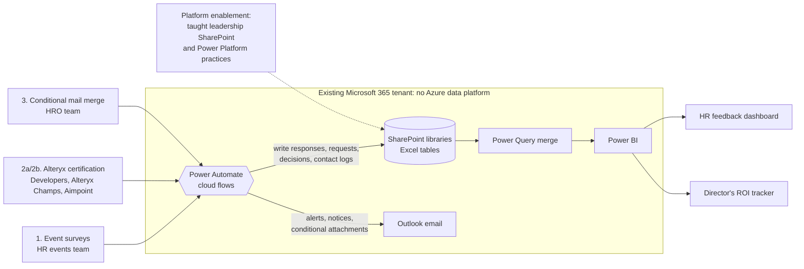
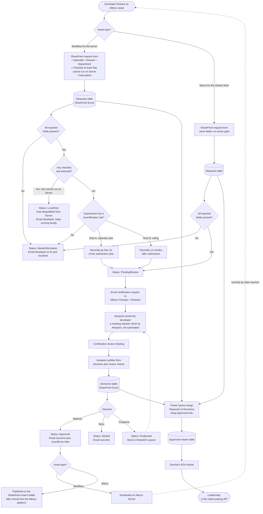
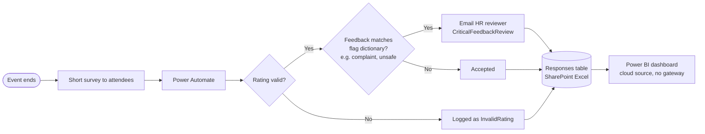
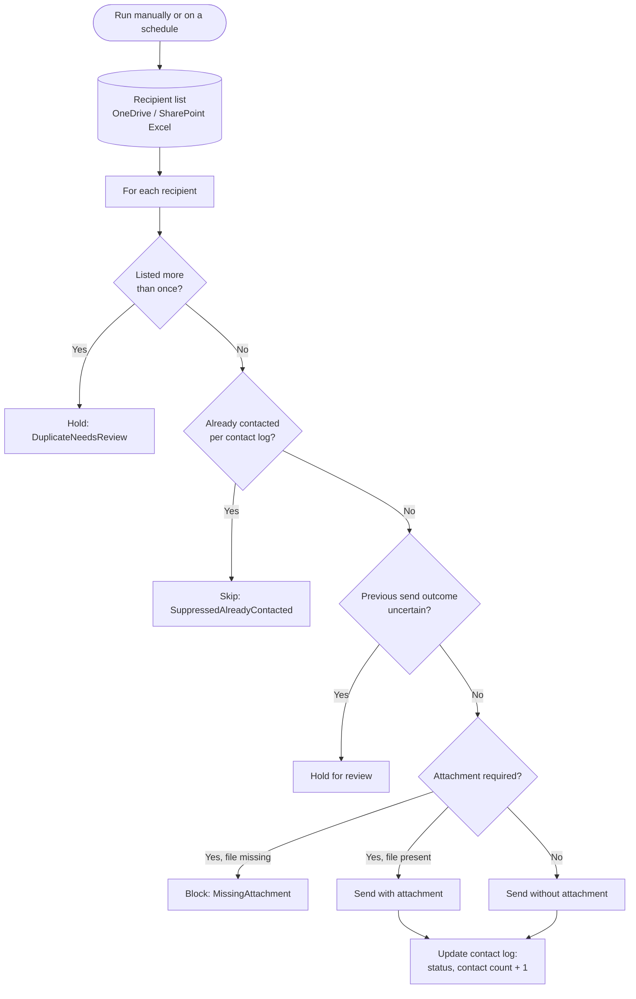

# Power Platform Portfolio

**Miguel Rodriguez** · Power Automate · Power BI / Power Query · Power Apps · SharePoint

This repository shows how three Power Platform solutions from Miguel's work at Lockton relate, through four demo repositories. Alteryx governance, which has two demos (workflow and macro certification), is the centerpiece. Each demo has its own repository with the flow definitions, fixtures, setup steps and run evidence. This page explains the operations behind them: who used each process, what decision it made, where the data went and how the program measured success.

> **About the demos.** The original solutions ran on Lockton's tenant with real employee data and are not published. Each demo is a **synthetic reconstruction** built in November 2026 on a personal Microsoft 365 tenant. People, departments, tool names, record IDs and date rules are placeholders. No employer data, code or screenshots are included.

| Use case | What it shows | Demo repository |
|---|---|---|
| 1. HR event surveys | Collection → SharePoint → Power BI, keyword routing of critical feedback | [power-platform-event-survey-demo](https://github.com/MRodriguez2010/power-platform-event-survey-demo) |
| 2a. Alteryx **workflow** server certification | Intake form, server-eligibility gate, department recertification rules, certifier decision, approved master | [power-platform-workflow-certification-demo](https://github.com/MRodriguez2010/power-platform-workflow-certification-demo) |
| 2b. Alteryx **macro** store certification | Same governance path without the server gate; approved macros published | [power-platform-macro-certification-demo](https://github.com/MRodriguez2010/power-platform-macro-certification-demo) |
| 3. HRO conditional mail merge | Branching rules, conditional attachments, contact log that suppresses repeat sends | [power-platform-conditional-mail-demo](https://github.com/MRodriguez2010/power-platform-conditional-mail-demo) |

The `demos/` folder links each repository as a Git submodule at the commit this page describes.

---

## The constraint that shaped every design

The organization ran on Microsoft 365, but it did **not** use Azure data lakes, Synapse pools, Dataverse or any managed database for this work. Leadership kept program data in local Excel files. Each solution therefore uses only what was licensed and approved:

- **SharePoint** document libraries and Excel tables as the system of record
- **Power Automate** cloud flows for intake, rules, routing, logging and email
- **Power Query** to merge tables into reporting sets
- **Power BI** on cloud sources, so refresh needed no on-premises gateway
- **SharePoint permissions** for access control, instead of buying third-party tools

That last point mattered most for HRO mail merges, whose source data included protected health information. Keeping everything inside the existing tenant avoided sending that data to an outside vendor.

---

## How the four solutions relate



All three use the same pattern: **capture → apply rules in a flow → write a record → notify the right people → report from the record**. Only the business rules change.

---

## 2. Alteryx governance: operational flow

The firm rolled out Alteryx, and the analytics director made a small internal team, the **Alteryx Champs** (Miguel and a few colleagues), responsible for governing it. The partner **Aimpoint** performed certifications. Two processes protected the shared environment:

- **Workflow server certification.** A workflow had to be certified before it could run on the shared Alteryx Server.
- **Macro store certification.** A reusable macro had to be certified before it was published for everyone.

### Stakeholders

| Stakeholder | Role in the process | What they needed |
|---|---|---|
| **Developer** (any division) | Submits the SharePoint request form; attends the review meeting | A clear yes/no on server eligibility, fast scheduling, a known recertification date |
| **Alteryx Champs** (internal team) | Own the forms, flows and lists; receive every eligible request; support developers | One queue of requests, fewer manual checks, consistent rules |
| **Aimpoint** (certification partner) | Schedules the meeting with the developer; reviews; submits the decision form | Complete request details before the meeting; one place to record decisions |
| **Analytics director** (program owner) | Owns the ROI tracker; reports adoption to leadership | A trustworthy list of certified assets |
| **Leadership** | Funds the program | Evidence the rollout is working |

### End-to-end flow (logic expanded)



### Design decisions

- **Intake and decision are separate forms and tables.** The developer and the certifier are different people at different organizations, filling in forms at different times. Separate tables give each party one simple form and keep an audit trail of who decided what. Power Query joins them afterwards.
- **The server gate fails fast.** The checklist lists only tools that cannot run on Server. Checking any of them disqualifies the workflow before a certifier spends time on it. The developer is told it can still run locally.
- **Recertification is a rule, not a judgment.** Some departments recertified at year-end; others every 12 months. Applying the rule at intake means the date is known before the meeting and is the same for everyone.
- **Macros share the path but skip the gate.** A macro isn't scheduled on the server, so the server-tool check doesn't apply. It goes straight to Aimpoint.
- **Scheduling stayed with Aimpoint.** The flow notified Aimpoint, and Aimpoint sent the meeting request. The demo doesn't claim calendar automation.

### ROI tracking

The **approved master** is the output that mattered to the program. Power Query merged the request and decision tables and kept only approved records. That gave one row per certified asset with its submitter, division, department, asset type, approval and recertification dates.

The director's ROI tracker referenced this table, so program reporting came from the same records the process created. Nobody kept a separate list. Because every approved row carries its division, department, asset type and dates, the table supports adoption questions such as how many assets were certified, where, and which are due for recertification. That was how the program showed its success.

The demos reproduce the approved master ([workflow demo, `power-query/`](https://github.com/MRodriguez2010/power-platform-workflow-certification-demo/tree/main/power-query)). They don't reproduce the ROI tracker or its financial figures, which belonged to the employer.

### Platform enablement: why SharePoint instead of local Excel

The director wanted to hand program administration to the Alteryx Champs, but leadership's material lived in local Excel files. As the team's Power Platform subject-matter expert, Miguel showed leadership how to organize it in SharePoint and Power Platform:

- one shared location for program material instead of copies on laptops
- folder-level permissions, so each group saw only what it needed
- forms and flows that write straight to the shared tables

The security model was the deciding factor: one place, with specific access per folder. This is what made the certification processes above possible.

---

## 1. HR event surveys



This was the simplest of the three. A keyword dictionary is cheap and transparent, but it matches substrings, not meaning: "No complaint from me" is flagged too. So flagged feedback goes to a person to read, not to an automatic action. Details are in the [event survey demo](https://github.com/MRodriguez2010/power-platform-event-survey-demo).

## 3. HRO conditional mail merge



The HRO team ran mail merges regularly, but Word/Outlook mail merge couldn't branch on edge cases or attach a file only for some recipients. Instead of buying a third-party tool, Miguel built the merges in Power Automate with OneDrive. Each requirement became a branch, and conditional attachments were added where needed. A contact log recorded who had been emailed and how many times, so later runs left them out. The data never left the tenant, which mattered because it included protected health information. Details are in the [conditional mail demo](https://github.com/MRodriguez2010/power-platform-conditional-mail-demo).

---

## Current demo state (November 18, 2026)

On top of what the four demo repositories document, the live demos were extended:

- **All four flows send real demo emails** to a single test inbox. Every subject is tagged `[DEMO]`, and every email names the stakeholder who would receive it in production.
- **The event survey has a canvas Power App** (Email, Name, 1–5 star rating, open feedback). It calls the flow and shows the response reference and whether the comment was flagged.
- **The mail merge has a reset input** that re-arms the sample recipients, so the duplicate suppression can be shown repeatedly.

The current flow definitions are in [`current-flows/`](current-flows/), with tenant addresses replaced by placeholders. The individual demo repositories still describe the earlier preview-only versions.

## Repository layout

```
README.md                 this page
docs/
  ALTERYX-GOVERNANCE.md   statuses, data model, rules, notifications
  HR-AUTOMATIONS.md       survey and mail-merge operating notes
  PLATFORM-DESIGN.md      constraints, security model, why no Azure data platform
current-flows/            sanitized Power Automate definitions and the Power App controls
demos/                    the four demo repositories, as submodules
```
